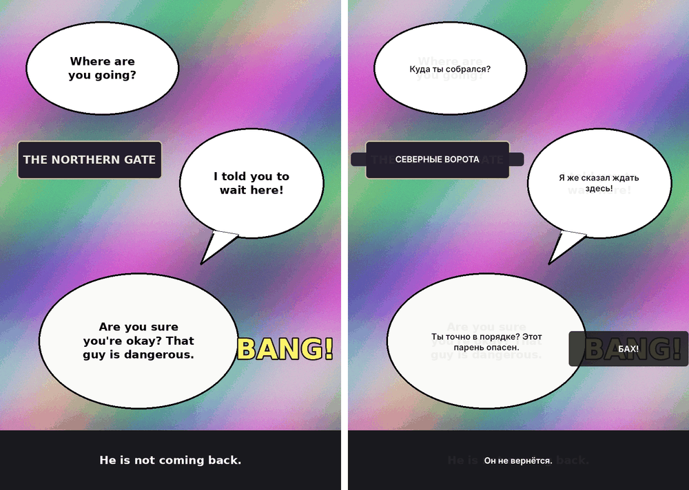
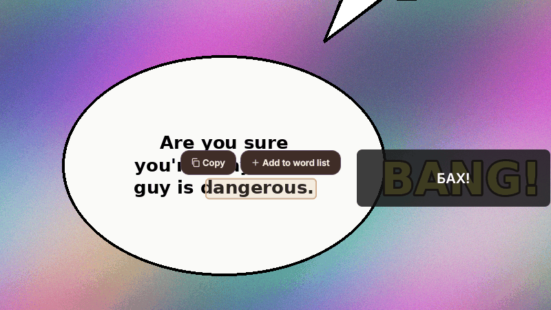
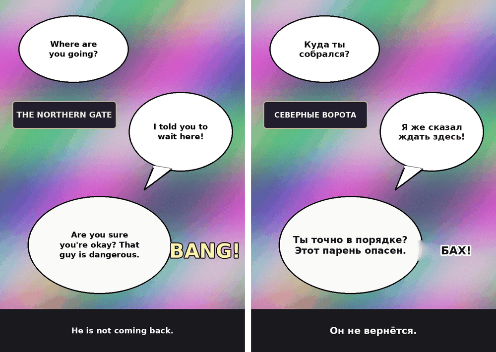
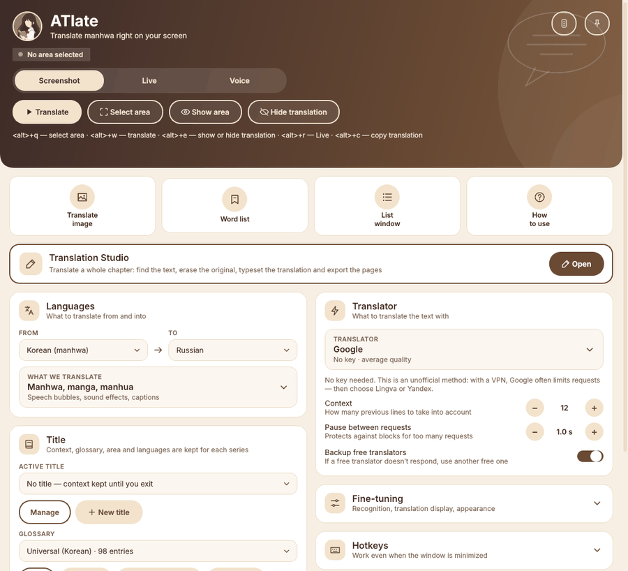
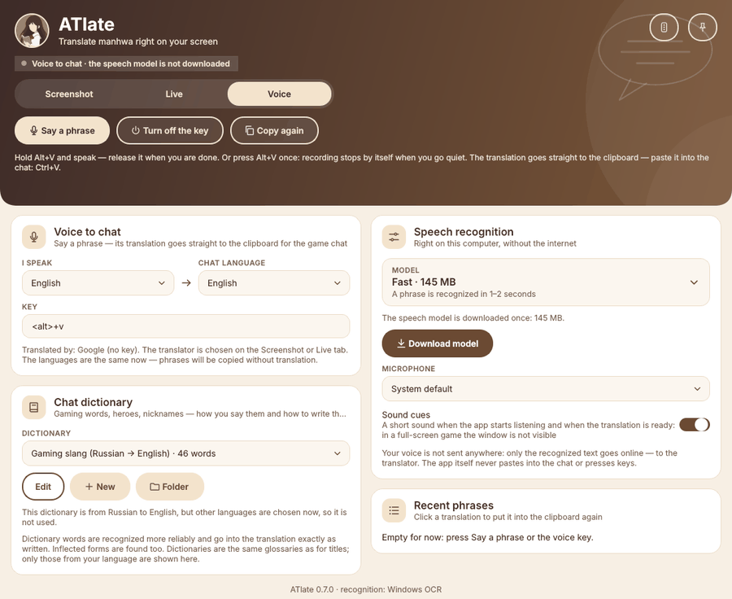
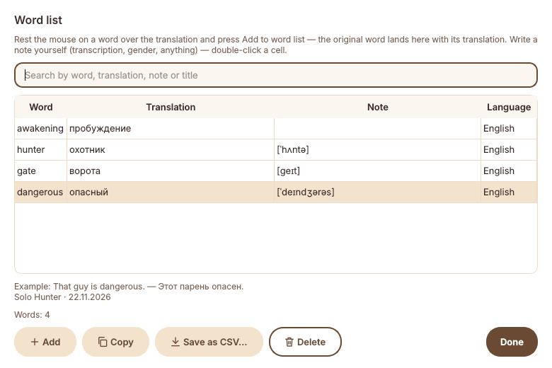

# ATlate

[](https://github.com/agoiel/ATlate/actions/workflows/android.yml)
[](https://github.com/agoiel/ATlate/actions/workflows/desktop-windows.yml)
[](LICENSE)

Screen translator for manhwa, manga and manhua — Windows and Android, free and open source.
Переводчик манхвы, манги и маньхуа прямо с экрана — для Windows и Android, бесплатный и открытый.

**[⬇ Download / Скачать](https://github.com/agoiel/ATlate/releases/latest)** · [English](#english) · [Русский](#по-русски)



## English

ATlate reads the text on your screen and puts the translation right over the speech bubbles —
in any reader app or website, nothing to save or upload.

- **Screen translator** (Windows and Android) — select an area once, then translate with one key or let
  **Live** translate by itself when the page stops scrolling. Text recognition runs on your device.
  Tilted text gets a tilted translation; captions, boxes and sound effects are handled too.
- **Studio** (Windows) — translate a whole chapter: it finds the text on every page, erases it
  (cleaning) and typesets the translation into the bubbles. Everything can be fixed by hand, then exported.
- **Words on screen & word list** — rest the mouse (or hold a finger) on an unfamiliar word: the original
  shows up with **Copy** and **Add to word list**. The list keeps the word, its translation, your note and the
  phrase it came from; export it to CSV for Anki.
- **Voice to chat** (Windows) — for online games: hold a key, say a phrase, and its translation is in the
  clipboard, ready to paste into the game chat. Speech is recognized offline (Whisper).
- **Translators** — free Google, Yandex, DuckDuckGo and Lingva; DeepL, Microsoft and Papago with a key;
  AI translators Gemini, Claude and any OpenAI-compatible server (including local models); an offline
  translator on Android. Glossaries and per-series context keep names and terms consistent.
- **Source languages:** Korean, Japanese, Chinese (simplified and traditional), English, German, Spanish,
  Portuguese, Indonesian, Filipino and any other Latin-script language. **18 target languages.**
  Interface in English and Russian.

| Words on screen | Studio: before and after |
|---|---|
|  |  |

| Main window | Voice to chat |
|---|---|
|  |  |

**Install.** Download from [Releases](https://github.com/agoiel/ATlate/releases/latest):
`ATlate.apk` for Android 8.0+ (needs Google Play services) or `ATlate-windows.zip` for Windows 10/11 —
unzip and run `ATlate.exe`, no Python needed. The builds are not signed, so Windows SmartScreen and
Play Protect may warn about an unknown app: choose “More info → Run anyway” / “Install anyway”.

**Feedback:** arcgobabuiss@gmail.com — also in the app (Feedback card). **License:** [GPL-3.0](LICENSE).

## По-русски

**ATlate** — инструмент для перевода манхвы, манги и маньхуа. Подходит и тем, кто
просто читает, и тем, кто переводит тайтлы целиком.

- **Экранный переводчик — для чтения.** Выделите область экрана, и перевод появится
  поверх облаков с текстом. Работает с любой читалкой или сайтом, ничего не нужно
  сохранять и загружать. Есть на **Android** и **Windows**.
- **Студия — для перевода глав.** Откройте главу, и Студия найдёт текст на каждой
  странице, переведёт его, сотрёт оригинал (клин) и впишет перевод в облака (тайп).
  Всё можно поправить вручную, а готовые страницы выгрузить. Пока только на **Windows**.

Обе части используют общие переводчики, глоссарии и контекст тайтлов.

## Возможности

### Экранный переводчик

- **Перевод поверх облаков** — текст заменяется прямо на странице, не нужно переключаться между окнами.
- **Умное распознавание облаков** — строки собираются в реплики, соседние облака не склеиваются, звуки и надписи на фоне можно пропускать.
- **Текст на сложных фонах** — несколько проходов распознавания находят светлый текст на тёмном фоне, цветные надписи и текст поверх рисунка. Проходы идут одновременно, поэтому тщательные режимы почти не медленнее.
- **Наклонный текст** — если оригинал стоит под углом, перевод встаёт под тем же углом и на то же место. Работает и для манхвы, и в режиме «Текст на экране»; отключается в настройках.
- **Скриншот и Live** — перевод по нажатию или автоматически, когда страница остановилась после прокрутки.
- **Компактный режим** (Windows) — вместо большого окна остаётся маленькая панель поверх экрана. При наведении она раскрывается: перевод, зона и выход из режима, кнопка под мышью сама вытягивается вбок, и в ней появляются её действия. Сама сворачивается через несколько секунд.
- **Режим «Текст на экране»** — для обычного текста: игр, сайтов, интерфейсов.
- **Слова на экране и словарик** — незнакомое слово можно выучить: на ПК задержите на нём мышь, на телефоне — палец. Плашка перевода на время прячется, слово оригинала подсвечивается, над ним появляются «Копировать» и «В словарик». В словарике — слово, перевод (из глоссария тайтла или от переводчика), ваша заметка (например, транскрипция) и фраза, где слово встретилось. Словарик можно править, искать по нему и выгрузить в CSV для карточек Anki. Выключается в настройках.

| Слова на экране | Словарик |
|---|---|
|  |  |

### Студия (Windows)

- **Глава целиком** — папка с картинками, архив `.zip`/`.cbz` или отдельные страницы. Длинные вебтун-ленты тоже подходят.
- **Клин** — текст в облаках и на плашках закрашивается цветом фона, надписи поверх рисунка закрываются соседним фоном.
- **Тайп** — перевод вписывается в форму облака, размер шрифта подбирается сам. Можно выбрать свой шрифт, ЗАГЛАВНЫЕ буквы, цвет и обводку.
- **Наклонный текст** — если оригинал стоит под углом (крики, звуки, косые надписи), перевод встаёт под тем же углом и на то же место. Угол определяется сам, его можно поправить у любого блока или отключить в оформлении.
- **Ручная правка** — исправить оригинал или перевод, перевести блок заново, подвинуть или растянуть рамку, обвести пропущенный текст.
- **Выгрузка** — готовые страницы в PNG или JPG. Проект сохраняется сам, к главе можно вернуться позже.
- **Пауза и нагрузка на ПК** — перевод главы можно поставить на паузу или остановить в любой момент. Студия работает с пониженным приоритетом, чтобы компьютер не тормозил; нагрузку (щадящая, обычная, максимальная) можно менять прямо во время перевода.

### Голос в чат (Windows)

- **Для онлайн-игр** — нажмите `Alt+V` и скажите фразу: перевод сразу окажется в буфере обмена, остаётся вставить его в чат (`Ctrl+V`). Сама программа в чат ничего не вставляет и клавиш не нажимает.
- **Своя вкладка** — «Скриншот | Live | Голос» в шапке: на вкладке «Голос» окно показывает только настройки голоса, кнопку «Сказать фразу» и последние фразы — щелчок по переводу снова кладёт его в буфер.
- **Словарь для чата** — игровые слова, герои, ники: как вы их говорите и как писать в чат. Слова из словаря распознаются увереннее и попадают в перевод так, как записаны («го на мид» → «go mid»), склонения находятся сами. Есть готовый словарь игрового сленга (русский → английский); свой словарь — это обычный глоссарий, его можно завести под каждую игру.
- **Как рация или одним нажатием** — удерживайте клавишу, пока говорите, или нажмите один раз: запись остановится сама, когда вы замолчите. Внизу экрана видно, что программа слушает и что попало в буфер; короткие звуки подскажут то же в полноэкранной игре.
- **Без интернета** — речь распознаётся прямо на компьютере (Whisper). Модель скачивается один раз на вкладке «Голос»: быстрая (145 МБ) или точная (484 МБ). В интернет уходит только текст — выбранному переводчику.
- **Свой язык и язык чата** — фраза, сказанная сразу на языке чата, копируется без перевода. Для чата доступны те же языки, что для перевода, а также корейский, японский и китайский. Язык чата и словарь запоминаются у тайтла — можно завести тайтл под каждую игру.

### Общее

- **Десять переводчиков на выбор** — бесплатные Google, Яндекс, DuckDuckGo и Lingva, а также DeepL, Microsoft, Papago и ИИ: Gemini, Claude и OpenAI-совместимые.
- **Офлайн-перевод** (Android) — переводчик «Офлайн» переводит прямо на телефоне, без интернета; языки скачиваются один раз, около 30 МБ каждый.
- **Авто-глоссарий** — с ИИ-переводчиками (Gemini, Claude, OpenAI-совместимые) глоссарий может пополняться сам: новые имена и термины добавляются из переводов, повторы и случайные фразы отсеиваются. Добавленное помечено «авто» в редакторе.
- **Глоссарий для каждого тайтла** — имена, звания и термины переводятся одинаково от главы к главе. Есть готовые универсальные глоссарии для корейского и английского.
- **Тайтлы с контекстом** — переводчик видит предыдущие реплики и лучше понимает, кто говорит; контекст каждого тайтла сохраняется отдельно.
- **Экономия лимитов** — уже переведённые облака запоминаются и не отправляются повторно.
- **Языки оригинала** — корейский, японский, китайский (упрощённый и традиционный), английский, немецкий, испанский, португальский, индонезийский, филиппинский. Для любого другого языка на латинице — «Латиница (язык определит переводчик)». Языки на латинице не требуют отдельного распознавания: в Windows подойдёт уже установленный английский пакет.
- **Автоопределение языка** — в экранном переводчике можно выбрать «Авто»: программа сама поймёт, на каком языке текст в выделенной области, и переключится, если язык сменился. На Windows выбор идёт из языков, для которых установлено распознавание.
- **Языки перевода** — 18 языков: русский, украинский, белорусский, казахский, узбекский, английский, немецкий, французский, испанский, португальский, итальянский, польский, чешский, турецкий, индонезийский, вьетнамский, тайский, арабский.
- **Интерфейс на русском и английском** — по языку системы или вручную в настройках.

## Установка

### Android

Требуется Android 8.0 или новее и сервисы Google Play.

1. Скачайте `ATlate.apk` со страницы [последнего релиза](https://github.com/agoiel/ATlate/releases/latest).
2. Откройте файл на телефоне и разрешите установку из этого источника.

Если Play Защита предупредит о неизвестном приложении, нажмите «Подробнее» → «Всё равно установить».
Новые версии устанавливаются поверх старых, данные сохраняются.

### Windows

Требуется Windows 10 или 11.

1. Скачайте `ATlate-windows.zip` со страницы [последнего релиза](https://github.com/agoiel/ATlate/releases/latest).
2. Распакуйте архив и запустите `ATlate.exe`.
3. Если в Windows нет распознавания текста для выбранного языка, программа предложит докачать его.
   Windows один раз попросит права администратора.

Если Windows покажет «Система Windows защитила ваш компьютер», нажмите «Подробнее» →
«Выполнить в любом случае». Так бывает с программами без цифровой подписи.

Запуск из исходников и тонкая настройка — в [инструкции для Windows](desktop/README.md).

## Как пользоваться

### Android

1. Откройте ATlate, выберите языки и переводчик.
2. Нажмите **«Запустить переводчик»** и выдайте разрешения: показ поверх других приложений,
   уведомления и запись экрана (выберите «Весь экран»).
3. Откройте читалку. На экране появится круглая кнопка **«Аа»**.

| Действие | Что произойдёт |
|---|---|
| Нажатие на «Аа» | Перевести область чтения. В первый раз её нужно выделить пальцем |
| Нажатие на «✕» | Убрать перевод |
| Долгое нажатие | Выделить новую область |
| Перетаскивание | Переместить кнопку |

Чтобы проверить работу без читалки, нажмите **«Проверить на картинке»** или поделитесь
скриншотом с ATlate.

### Windows

| Клавиши | Действие |
|---|---|
| `Alt+Q` | Выделить область чтения |
| `Alt+W` | Перевести |
| `Alt+E` | Показать или скрыть перевод |
| `Alt+R` | Автоперевод при прокрутке |
| `Alt+C` | Скопировать перевод |
| `Alt+V` | Голос в чат (когда функция включена) |

Клавиши можно изменить в настройках.

### Студия (Windows)

1. В главном окне нажмите **«Открыть»** на баннере «Студия перевода».
2. Откройте главу: перетащите в окно папку с картинками или архив `.zip`/`.cbz`.
3. Нажмите **«Перевести главу»**. Страницы обработаются по очереди — за прогрессом видно внизу окна.
4. Проверьте страницы. Справа — блоки текста: поправьте перевод, если нужно, или выберите блок
   на странице, чтобы подвинуть рамку и настроить стирание, размер, цвет и обводку.
   Пропущенный текст обведите кнопкой **«+ Блок»**.
5. Нажмите **«Выгрузить»**. Готовые страницы появятся в папке `ATlate/translated` рядом с главой.

Проект хранится в папке `ATlate` рядом с главой: если открыть главу снова, все правки на месте.
Шрифт меняется в разделе «Оформление». Свой шрифт `.ttf`/`.otf` добавляется кнопкой
«Добавить шрифт» — он копируется в папку `fonts` рядом с программой.

## Переводчики

| Переводчик | Нужен ключ | Бесплатно | Качество |
|---|---|---|---|
| Google | Нет | Да | Среднее |
| Яндекс | Нет (ключ Yandex Cloud — по желанию) | Да | Хорошее |
| DuckDuckGo (Bing) | Нет | Да | Среднее |
| Lingva (Google через посредника) | Нет | Да | Среднее |
| [DeepL](https://www.deepl.com/pro-api) | Да | 500 тыс. символов в месяц | Хорошее |
| [Microsoft](https://portal.azure.com) | Да | 2 млн символов в месяц | Среднее |
| [Papago](https://www.ncloud.com/product/aiService/papagoTranslation) | Да | Нет | Лучшее для корейского |
| [Gemini](https://aistudio.google.com/apikey) | Да | Есть бесплатный лимит | Высокое, ИИ |
| [Claude](https://platform.claude.com) | Да | Нет | Высокое, ИИ |
| OpenAI-совместимые | Обычно да | Зависит от сервиса | Высокое, ИИ |

Одна глава — это примерно 2–4 тысячи символов. Ключ вводится в настройках выбранного переводчика.

Google, Яндекс без ключа и DuckDuckGo работают через неофициальные способы и могут
временно перестать отвечать — тогда выберите другой переводчик. Если Google ограничивает
запросы при включённом VPN, выберите Lingva.

## Глоссарий

Глоссарий помогает переводить имена и термины одинаково во всех главах. Создайте отдельный
глоссарий для каждого тайтла и заполните его строками такого вида:

```
헌터 = охотник
형 = хён | обращение к старшему мужчине
```

Слева — оригинал, справа — перевод. После `|` можно добавить заметку: кто это, пол, как
обращаться. Заметки учитывают ИИ-переводчики (Gemini и OpenAI-совместимые).

Формат глоссариев одинаковый на Android и Windows.

## Частые вопросы

**Почему Android каждый раз спрашивает разрешение на запись экрана?**
Это требование системы. Разрешение действует до остановки переводчика или блокировки экрана.

**Работает ли без интернета?**
Распознавание текста (и речи в «Голосе в чат») работает на устройстве. Перевод выполняется
онлайн-сервисами; без интернета переводит только переводчик «Офлайн» на Android — его языки
скачиваются один раз. На Android модели распознавания текста скачиваются при первом использовании.

**Не работает на моём Huawei или Honor.**
Для распознавания на Android нужны сервисы Google Play. На телефонах без них оно недоступно.

**Текст на тёмном или пёстром фоне, цветной текст или надписи без облака не находятся.**
В тонкой настройке выберите режим распознавания «Тщательный» или «Максимальный». Страница
проверяется в нескольких вариантах — с инверсией, выровненным фоном и цветовым контрастом, —
поэтому находится и светлый текст на тёмном фоне, и цветные надписи. Каждый проход добавляет
примерно 0,2–0,4 секунды.

**В Студии текст поверх рисунка стёрся пятном или задел контур облака.**
Для надписей поверх рисунка Студия дорисовывает фон по соседним пикселям — на однотонном
и плавном фоне это незаметно, на детальном рисунке остаётся пятно. Выберите у блока
«Не стирать» или поправьте рамку блока, чтобы она не заходила на контур.

**Текст распознаётся с ошибками или облака склеиваются.**
Откройте тонкую настройку и измените параметр склейки строк. На Windows также помогает
увеличить параметр «Увеличение перед OCR».

## Конфиденциальность

Распознанный текст отправляется только в выбранный вами сервис перевода. Скриншоты и страницы глав никуда
не загружаются, распознавание выполняется на устройстве. Голос с микрофона («Голос в чат») тоже
распознаётся на компьютере и никуда не отправляется — переводчику уходит только распознанный текст. Ключи API хранятся только
на вашем устройстве.

## Обратная связь

Нашли ошибку, есть идея или вопрос — пишите на **arcgobabuiss@gmail.com** (адрес есть и в самой программе,
в карточке «Обратная связь»). Если программа на ПК падала, приложите файл `error.log` из её папки.

## Лицензия

ATlate — свободная программа под лицензией [GNU GPL v3](LICENSE): её можно бесплатно использовать,
изучать, изменять и распространять, но любая программа на её основе тоже должна быть открытой и под
той же лицензией. Сторонние компоненты и их лицензии — в файле [NOTICE](NOTICE).

## Сборка из исходников

```
android/   приложение для Android (Kotlin)
desktop/   программа для Windows (Python)
```

**Релизы** собираются автоматически: после публикации релиза на странице Releases
GitHub Actions собирает APK и exe и прикрепляет их к нему.

**Android.** Тестовый APK собирается при каждом изменении в папке `android/`. Для локальной сборки нужны JDK 17 и Android SDK:

```
cd android
gradle assembleRelease
```

**Windows.** После первого запуска `run.bat` выполните `build.bat`, чтобы собрать
`ATlate.exe` в папке `desktop/dist/ATlate/`.
